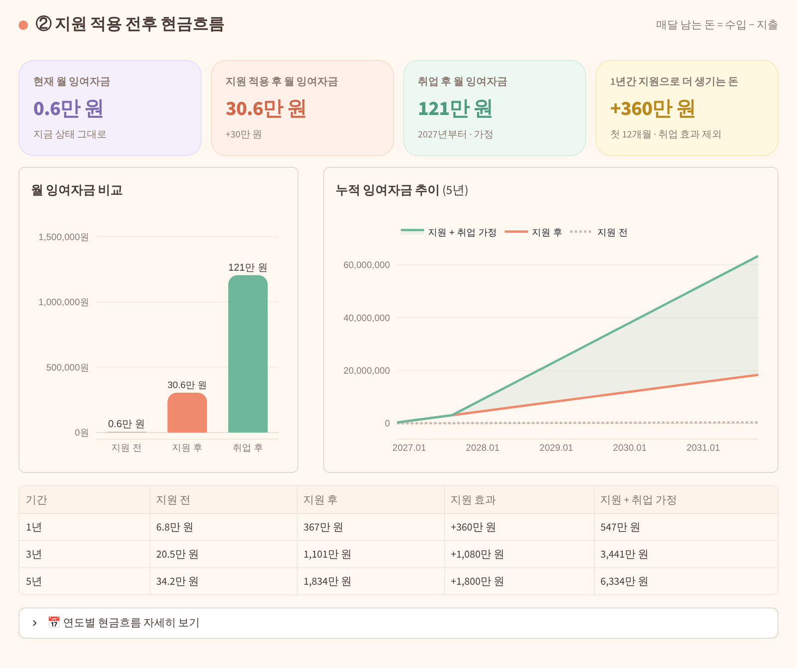
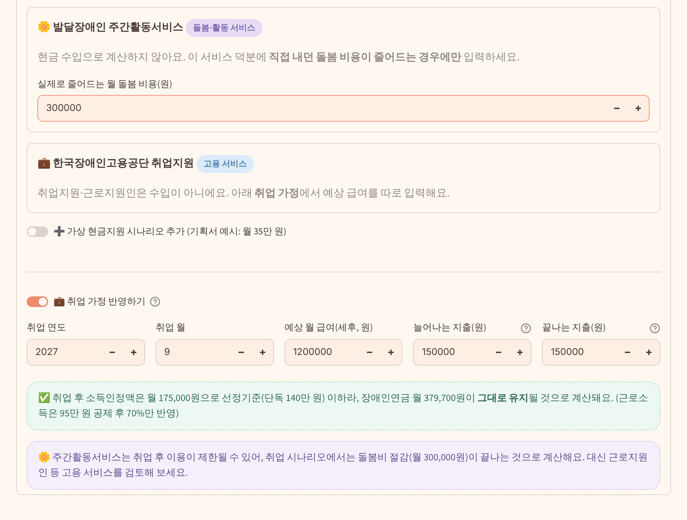
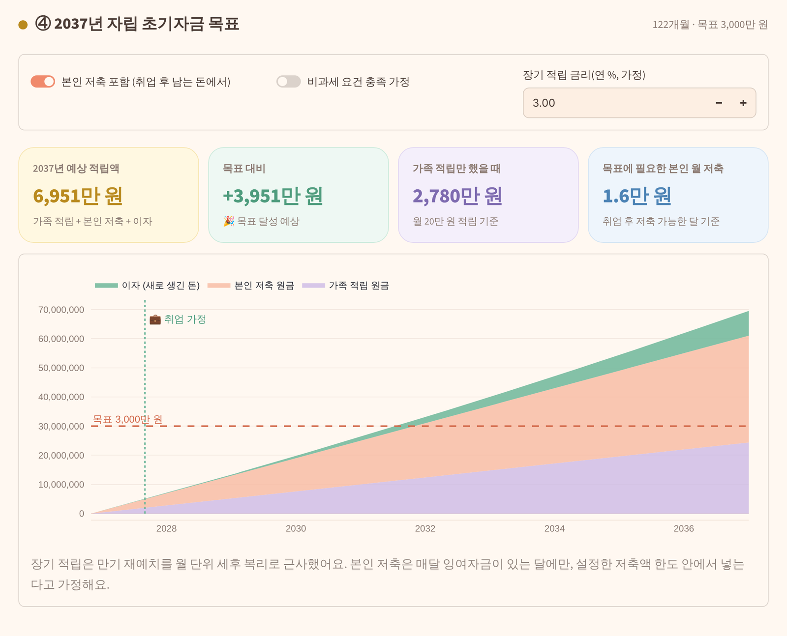
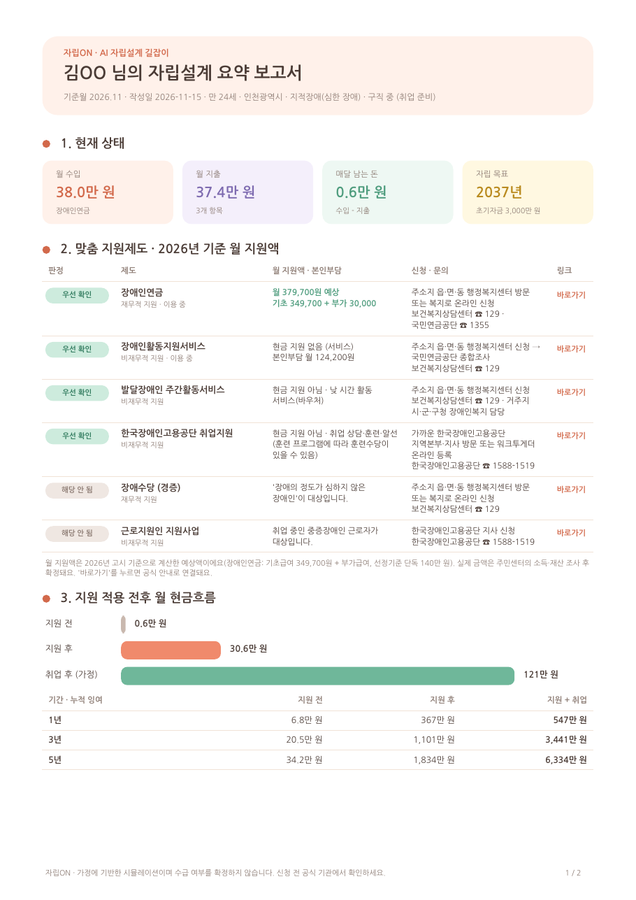
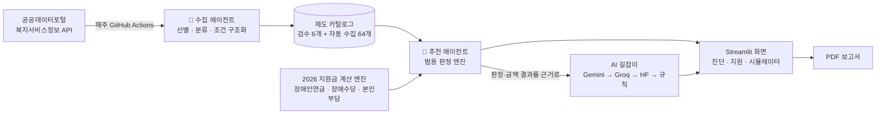

# 자립ON 🌱 발달장애인 맞춤형 AI 자립설계 길잡이

발달장애인의 상황을 입력하면 받을 수 있는 지원제도와 2026년 기준 월 지원액을 계산합니다.
지원을 받았을 때 현금흐름과 자립자금이 어떻게 달라지는지도 함께 시뮬레이션합니다.

AFPK 영 플래너 챌린지 · Streamlit · Python · Gemini


## 한눈에 보기

| | |
| --- | --- |
| 대상 | 발달장애인 본인과 보호자 (공모전 사례: 인천에 사는 만 24세 지적장애인 딸, 2037년 자립 목표) |
| 기능 | ① 재무·비재무 상황 진단 → ② 맞춤 지원제도와 월 지원액 → ③ 지원 전후 현금흐름·예적금·자립자금 시뮬레이션 |
| 방식 | 자격 판정과 금액은 Python 규칙 엔진이 계산하고, AI는 그 결과를 바탕으로 쉽게 설명합니다 |
| 데이터 | 공공데이터포털 복지서비스정보 461건 중 장애인 대상 64건을 수집 에이전트가 정리합니다 |

## 지원 전후 비교

딸 사례에 주간활동서비스와 한국장애인고용공단 취업지원을 적용한 결과입니다.



| | 지금 | 주간활동서비스 이용 | + 취업지원으로 취업 |
| --- | --- | --- | --- |
| 월 잉여자금 | 0.6만 원 | 30.6만 원 | 121만 원 |
| 5년 누적 | 34만 원 | 1,834만 원 | 6,334만 원 |

- 주간활동서비스는 현금이 아니라 서비스입니다. 그래서 따로 내던 낮 돌봄 비용이 줄어드는 만큼(가정: 월 30만 원)만 반영합니다.
- 취업(가정: 2027년 9월, 월 120만 원)하면 주간활동서비스 이용이 제한됩니다. 취업 시나리오에서는 돌봄비 절감이 끝나는 것으로 자동 계산합니다.
- 취업 후에도 장애인연금은 월 379,700원이 유지됩니다. 근로소득은 95만 원을 뺀 뒤 70%만 소득으로 보기 때문에, 소득인정액이 17.5만 원에 그치기 때문입니다.

<details>
<summary>시나리오 설정 화면 보기</summary>


</details>

## 주요 화면

<table>
<tr>
<td width="50%"><b>① 나의 자립 진단</b><br>기본 정보, 재무 정보, 자립 목표를 입력하면 진단 요약을 보여줍니다.<br></td>
<td width="50%"><b>우리 가족 재무상태</b><br>보고서 원자료로 AFPK 재무비율 12개를 다시 계산하고, 가족 타임라인과 함께 보여줍니다.<br></td>
</tr>
<tr>
<td><b>② AI 맞춤 지원</b><br>제도마다 해당 여부, 2026년 기준 월 지원액, 계산 과정, 신청 방법을 보여줍니다.<br></td>
<td><b>③ 2037년 자립 목표</b><br>가족 적립, 본인 저축, 이자를 나눠서 목표까지의 진행 상황을 보여줍니다.<br><br><br><b>📄 자립설계 요약 PDF</b><br>제도별 월 지원액(공식 링크 포함)과 시뮬레이션 결과를 한 파일로 내려받을 수 있습니다.<br></td>
</tr>
</table>

AI 길잡이에게는 제도뿐 아니라 상속, 신탁, 후견, 세금도 물어볼 수 있습니다. 예를 들어 "딸이 취업하면 장애인연금은 얼마가 돼요?"라고 물으면, 엔진이 계산한 월급별 연금액을 바탕으로 "월 200만 원까지는 379,700원 유지, 250만 원이면 345,000원"처럼 답합니다.

## 동작 구조



설계 원칙
1. 판정과 계산은 규칙 엔진이 맡고, AI는 설명만 합니다. AI는 수급 여부나 금액을 정하지 않습니다.
2. 현금 지원만 수입에 더합니다. 돌봄·고용 서비스는 실제로 줄어든 본인 비용만 반영합니다.
3. 예·적금에 넣은 돈은 자산이 옮겨간 것일 뿐입니다. 순자산을 새로 늘리는 것은 이자뿐입니다.
4. 자동 수집한 제도는 사람이 검수하기 전까지 '우선 확인'으로 올리지 않습니다.

### 두 에이전트 구성

#### 📡 수집 에이전트 (`core/agents/collector.py`)
1. 수집: 공공데이터포털 「한국사회보장정보원_복지서비스정보」(15083323)의 최신 데이터를 가져옵니다. 「중앙부처복지서비스」 API(`--source bokjiro`)도 사용할 수 있습니다.
2. 선별: 제도명과 지원 대상을 기준으로 장애인 대상 제도만 남깁니다. 직접 검수한 제도와 이름이 겹치면 제외합니다.
3. 분류: 현금 지원과 금융(자산형성)은 재무적 지원, 돌봄과 고용은 비재무적 지원으로 나눕니다.
4. 구조화: 지원 대상 문장에서 나이, 장애유형, 장애정도, 취업상태 조건을 규칙으로 추출합니다. AI가 연결되어 있으면 한 번 더 다듬고, 허용된 값만 남기도록 검증합니다.
5. 저장: 출처(서비스 ID, 수집 시각, 추출 방식)와 함께 '검수 전' 상태로 `data/programs_collected.json`에 저장합니다. 매주 GitHub Actions로 실행되며, 테스트를 통과한 경우에만 커밋합니다.

#### 🧭 추천 에이전트 (`core/agents/recommender.py`)
- 직접 검수한 제도와 자동 수집한 제도를 합쳐 하나의 카탈로그를 만듭니다. 이름이 겹치면 검수한 제도를 우선합니다.
- 모든 제도를 같은 판정 엔진(`core/eligibility.py`)으로 판정합니다. 결과는 '우선 확인', '추가 정보 필요', '현재 조건과 맞지 않음' 중 하나이며, 현금 지원 제도는 2026년 기준 월 지원액도 계산합니다.
- 검수 전 제도는 '우선 확인'으로 올리지 않습니다.
- AI에게는 자격 판정을 맡기지 않고 추천 이유와 다음 할 일만 설명하게 합니다. 질문을 받으면 관련 제도와 사용자의 판정·금액 결과를 함께 근거로 넘깁니다.

### 2026년 기준 지원금 계산 (`core/benefits.py`)

| 제도 | 기준 |
| --- | --- |
| 장애인연금 | 기초급여 최대 349,700원 + 부가급여 9만·8만·3만 원 · 선정기준 단독 140만·부부 224만 원 · 본인과 배우자 소득만 반영 · 근로소득 95만 원 공제 후 70% · 재산 연 4% 환산 |
| 장애수당 (경증) | 기초생활수급자·차상위 월 6만 원 (보장시설 3만 원) |
| 활동지원 본인부담 | 생계·의료급여 면제 · 차상위 월 2만 원 · 일반 4~10% · 상한 월 216,200원 |

딸 사례는 월 379,700원으로 계산되며, 보고서 현금흐름표의 장애인연금 연 455만 원과 일치합니다. 모든 기준값은 출처와 함께 `PARAMS_2026` 한곳에서 관리합니다.

## 실행 방법

```bash
pip install -r requirements.txt
```

```bash
streamlit run app.py
```

AI 설명을 사용하려면 `.streamlit/secrets.toml`(배포 시에는 Streamlit Cloud의 Secrets)에 키를 입력합니다. 키가 없어도 모든 기능은 규칙 기반 설명으로 동작합니다.

```toml
GEMINI_API_KEY = "..."
```

```bash
python -m pytest -q
```

<details>
<summary>AI 연결 순서</summary>

키가 등록된 서비스만 아래 순서로 시도합니다. 서비스마다 모델 후보를 차례로 시도해 처음 성공한 모델을 계속 사용하고, 키나 크레딧 오류가 나면 해당 서비스만 건너뜁니다.

| 순서 | 키 | 서비스 · 모델 | 비용 |
| --- | --- | --- | --- |
| 1 | `OPENAI_API_KEY` | OpenAI · gpt-4o-mini | 유료 |
| 2 | `GEMINI_API_KEY` | Gemini · gemini-flash-lite-latest 등 | 무료 사용량 |
| 3 | `GROQ_API_KEY` | Groq · gpt-oss-20b, Llama-3.1-8B | 무료 사용량 |
| 4 | `HF_TOKEN` | Hugging Face · Llama-3.1-8B, Qwen3.5-9B 등 | 크레딧 필요 |

`python scripts/ai_check.py` 또는 GitHub Actions의 'AI 연결 점검'으로 키와 모델별 응답을 확인할 수 있습니다.
</details>

<details>
<summary>수집 에이전트 실행</summary>

1. 공공데이터포털에서 「한국사회보장정보원_복지서비스정보」를 활용신청하고 일반 인증키(Decoding)를 복사합니다.
2. GitHub 레포의 Settings → Secrets and variables → Actions에 `DATA_GO_KR_KEY`로 등록합니다.
3. Actions → 지원제도 수집 에이전트 → Run workflow를 실행합니다. 이후에는 매주 월요일에 자동으로 실행되고, 테스트를 통과하면 결과가 커밋됩니다.

```bash
DATA_GO_KR_KEY=... python -m core.agents.collector --limit 100
```

```bash
python -m core.agents.collector --from-dir tests/fixtures/bokjiro --no-llm
```
</details>

<details>
<summary>프로젝트 구조</summary>

```
app.py                       화면 3개 · 라우팅
core/benefits.py             2026년 지원금 계산 (장애인연금 · 장애수당 · 활동지원 본인부담)
core/eligibility.py          조건(criteria) 기반 범용 판정 엔진
core/finance.py              현금흐름 · 예금 · 적금 · 자립 목표 계산
core/household.py            가족 재무비율 (AFPK 3단계)
core/agents/collector.py     수집 에이전트 (공공데이터 → 구조화)
core/agents/recommender.py   추천 에이전트 (판정 · 설명 · 질의응답)
core/ai.py                   AI 연결 (멀티 프로바이더 · 모델 자동 선택)
core/report.py               PDF 보고서
data/                        제도 · 사례 · 법령 지식 · 수집 결과
tests/                       계산 · 판정 · 에이전트 테스트 55개
```
</details>

> 지원 내용과 금액, 기준은 매년 바뀝니다. 이 서비스는 수급 여부를 확정하지 않습니다.

---

## 🔧 트러블슈팅 · 발전 과정

MVP를 실제 데이터, 실제 AI, 실제 정책 기준에 연결하면서 겪은 핵심 문제 6가지입니다.

| # | 문제 | 해결 | 결과 |
| --- | --- | --- | --- |
| 1 | 정책 기준값 오류로 수급 판정이 틀림 | 고시 기준값으로 계산하는 지원금 계산 엔진 | 보고서 수치와 금액 일치 |
| 2 | 제도마다 판정 규칙을 코드로 작성해 확장이 어려움 | 데이터(`criteria`) 기반 범용 판정 엔진 | 새 제도를 코드 수정 없이 판정 |
| 3 | 공공데이터 API 연동이 계속 실패 | 실패 원인을 보여주는 수집 파이프라인 | 실데이터 461건 수집 |
| 4 | 수집 데이터에 엉뚱한 제도가 섞이고 신뢰도가 낮음 | 검수 단계 분리와 노출 정책 | 오탐 제거, 화면당 AI 설명 요청 69건 → 6건 |
| 5 | 무료 LLM 서비스 장애 (모델 중단, 크레딧 없음) | 여러 AI 서비스 자동 전환과 모델 자동 선택 | 무료 Gemini로 정상화, 장애 시 자동 대체 |
| 6 | AI 답변이 일반론에 그치고 수급을 확정하는 표현을 씀 | 역할 분리와 계산 결과·법령 지식 제공 | 엔진 계산값과 같은 숫자로 답변 |

<details>
<summary>1. 정책 기준값 오류 → 고시 기준값으로 계산하는 지원금 계산 엔진</summary>

- 문제: 장애인연금 판정에 쓴 선정기준액 228만 원은 사실 기초연금(65세 이상)의 기준이었습니다. 2026년 고시값(단독 140만 원)을 확인하는 과정에서 발견했으며, 소득 기준을 실제보다 1.6배 느슨하게 적용하고 있었습니다.
- 원인: 기준값이 판정 코드 여러 곳에 흩어져 있었고, 공식 자료와 대조하는 절차가 없었습니다.
- 해결: 2026년 고시값을 출처와 함께 `PARAMS_2026` 한곳에 모았습니다. 기준 이하인지만 비교하던 방식을 '소득인정액 계산 → 해당 여부 → 감액 → 월 지원액' 순서로 계산하는 엔진으로 바꿨습니다. 장애인연금은 본인과 배우자 소득만 보고 부모 소득은 보지 않는다는 규칙도 반영했습니다. 부모와 함께 사는 발달장애인에게는 이 규칙이 판정을 좌우합니다.
- 결과: 딸의 연금이 월 379,700원으로 계산되어 보고서의 연 455만 원과 일치합니다. 취업하면 연금을 자동으로 다시 계산해 "월 200만 원까지는 유지, 300만 원부터는 지급되지 않음" 같은 효과를 보여줍니다.
</details>

<details>
<summary>2. 제도별 하드코딩 → 데이터 기반 범용 판정 엔진</summary>

- 문제: 처음에는 제도 5개마다 판정 함수를 따로 만들었습니다. 수집 에이전트가 새 제도를 수십 개 가져오자, 제도가 늘 때마다 코드를 추가해야 하는 한계가 드러났습니다.
- 해결: 자격조건을 `criteria`라는 데이터 형식(연령, 장애유형, 장애정도, 취업상태, 돌봄 필요, 금액 계산)으로 바꾸고, 모든 제도를 하나의 `evaluate()` 함수로 판정하도록 구조를 바꿨습니다. 교체 전후 판정 결과가 같은지는 회귀 테스트로 확인했습니다.
- 결과: 직접 정리한 제도와 자동 수집한 제도를 같은 엔진이 코드 수정 없이 판정합니다. 기준이 바뀌면 JSON 데이터만 고치면 됩니다.
</details>

<details>
<summary>3. 공공데이터 API 연동 실패 → 실패 원인을 보여주는 수집 파이프라인</summary>

- 문제: GitHub Actions에서 수집이 `403`, `등록되지 않은 서비스키`, `timeout` 오류로 연달아 실패했습니다.
- 접근: 단순히 재시도하지 않고, 실패 원인이 로그에 드러나도록 만들었습니다. 공공데이터포털의 오류 코드를 쉬운 설명으로 바꾸고, 인증키는 가려서 출력했습니다. 키 형식과 서버 위치를 점검하는 단계도 추가했습니다.
- 원인과 해결: 해외 서버에서는 https 요청이 차단되어 http를 먼저 시도하도록 했습니다. 승인된 API가 호출하던 것과 다른 데이터셋(15083323)이어서 기본 데이터 소스를 바꿨습니다. 데이터마다 열 이름이 달라 키워드로 열을 찾도록 했습니다.
- 결과: 461건 중 장애인 대상 64건을 매주 자동으로 수집합니다. 실패하면 기존 데이터를 유지하고, 테스트를 통과한 경우에만 커밋합니다.
</details>

<details>
<summary>4. 수집 데이터의 오탐과 신뢰성 → 검수 단계 분리</summary>

- 문제: 첫 수집 결과에 '실종아동', '산재 직업훈련'처럼 요약에 '장애'라는 단어만 들어간 제도가 섞였습니다. 화면에는 제도 카드 69개가 표시되어 카드마다 AI 설명을 요청했습니다.
- 해결: 제도명과 지원 대상을 기준으로 다시 걸러내고, 오탐 사례를 테스트로 고정했습니다. 자동 수집한 제도는 '검수 전'으로 표시하고, 검수 전에는 '우선 확인'으로 올리지 않도록 엔진에서 막았습니다. 화면에서는 검수한 제도만 자세한 카드와 AI 설명으로 보여주고, 수집한 제도는 접힌 목록으로 분리했습니다.
- 결과: 오탐을 없애고, 화면당 AI 설명 요청을 69건에서 6건으로 줄였습니다.
</details>

<details>
<summary>5. 무료 LLM 서비스 장애 → 여러 AI 서비스 자동 전환</summary>

- 문제: 기본 AI 모델(Qwen2.5-7B)이 Hugging Face에서 지원 중단(400 오류)되었고, 다른 모델은 크레딧이 없다는 402 오류가 났습니다. AI가 실패하면 규칙 기반 문장으로 조용히 대체되어 문제가 잘 드러나지 않았습니다.
- 접근: 점검 스크립트를 만들어 토큰 권한, 사용 가능한 모델 126개, 주요 모델 15개의 실제 응답을 확인했습니다. 그 결과 모델이 아니라 계정에 무료 크레딧이 없다는 것이 원인임을 밝혔습니다.
- 해결: OpenAI → Gemini → Groq → Hugging Face 순서로 자동 전환하도록 만들었습니다. 서비스마다 여러 모델을 시도하고, 성공한 모델을 기억합니다. 지원하지 않는 모델이면 다음 모델로, 키나 크레딧 문제면 다음 서비스로 넘어갑니다.
- 결과: 무료로 쓸 수 있는 Gemini로 정상화했고, 한 서비스에 장애가 나도 서비스가 멈추지 않습니다.
</details>

<details>
<summary>6. AI 답변 품질과 신뢰성 → 역할 분리와 근거 제공</summary>

- 문제: AI가 "자격이 돼요"처럼 수급을 확정하는 표현을 썼습니다. 공식 자료 안에서만 답하게 했더니, 상속 질문에는 답하지 못했고 연금 질문에는 일반적인 설명만 했습니다.
- 해결: 판정, 금액, 이자는 규칙 엔진이 계산하고 AI는 설명만 하도록 역할을 나눴습니다. AI가 수집 데이터에서 뽑은 조건은 허용된 값인지 검증합니다. AI에게는 사용자의 판정·금액 결과, 월급별 연금 계산표, 확인한 법령 지식(장애인 신탁, 상속공제, 보험금 비과세, 후견)을 근거로 함께 전달합니다. 답변 형식과 피해야 할 표현을 정하고, 실제 답변으로 다시 확인했습니다.
- 결과: AI가 엔진 계산값과 같은 숫자로 답하며, 상속 질문에는 신탁, 수급 영향, 상속공제를 연결해 설명합니다.
</details>
